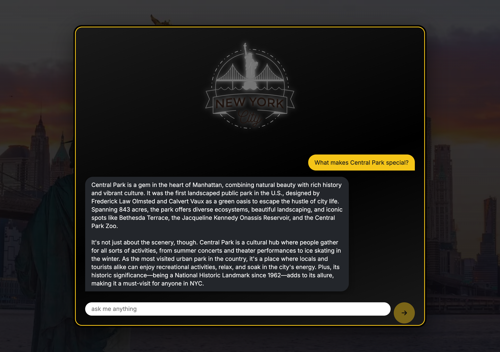
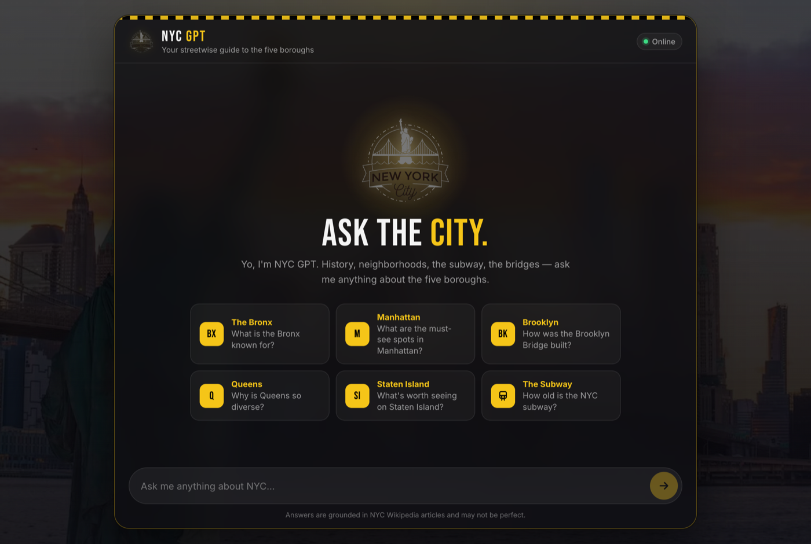
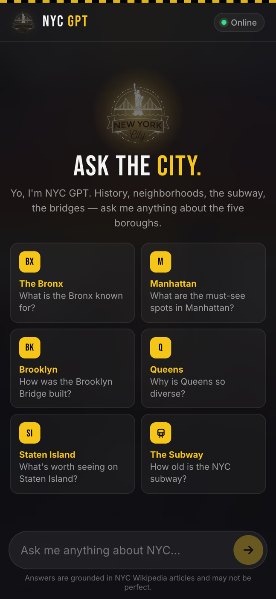

# NYC GPT

[](https://nyc-gpt.vercel.app)
[](https://github.com/WebDesign-MultiMedia/RAG-chatbot/actions/workflows/ci.yml)


A retrieval-augmented generation (RAG) chatbot with real New York City attitude. Ask it about the five boroughs, the subway, the bridges, the parks or the history. It pulls the most relevant passages from a vector database of NYC Wikipedia articles and streams back a grounded answer.

## Links

- **Try it live:** [https://nyc-gpt.vercel.app](https://nyc-gpt.vercel.app)
- **Source code:** [github.com/WebDesign-MultiMedia/RAG-chatbot](https://github.com/WebDesign-MultiMedia/RAG-chatbot)

**Try asking:** "How old is the NYC subway?", "How was the Brooklyn Bridge built?", "Why is Queens so diverse?" or "What makes Central Park special?"



<table>
  <tr>
    <td width="68%"></td>
    <td width="32%"></td>
  </tr>
  <tr>
    <td align="center"><sub>Desktop welcome screen</sub></td>
    <td align="center"><sub>Mobile (390 × 844)</sub></td>
  </tr>
</table>

## Interface

- **NYC look:** black glass panel over the skyline photo, taxi-yellow accents and a yellow-and-black taxi checker strip, set in Bebas Neue and Inter (loaded with `next/font`).
- **Welcome screen:** six suggestion cards (one per borough, plus the subway), each with a badge and a ready-to-send question.
- **Chat:** streaming answers with an assistant avatar and typing indicator, auto-scroll to the newest message, a friendly error bubble if a request fails, and a character counter for the 500-character limit.
- **Responsive:** full-screen layout on phones with notch and home-bar safe areas, a 16px input so iOS Safari doesn't zoom on focus, two-column cards, and tighter layouts for short screens and landscape. Checked at 320, 375, 390 and 430 px wide, in landscape and on iPad.
- **Accessible:** labelled input and Send button, `aria-live` conversation, visible focus rings, hover effects only on devices that can hover, and animations turned off for `prefers-reduced-motion`.

## Architecture

```
Seed (offline):  Wikipedia ─▶ scrape (Puppeteer) ─▶ chunk ─▶ embed (OpenAI) ─▶ AstraDB
Chat (per ask):  question ─▶ embed ─▶ vector search in AstraDB (top 10) ─▶ GPT ─▶ streamed answer
```

1. **Scrape.** `scripts/loadDb.ts` loads 16 NYC Wikipedia pages with LangChain's Puppeteer loader. It keeps only the article body and strips scripts, styles, nav, footers, references and navboxes.
2. **Chunk.** LangChain's `RecursiveCharacterTextSplitter` splits the text into 512-character chunks with 100 characters of overlap (about 3,300 chunks in total).
3. **Embed.** Chunks are embedded in batches with OpenAI `text-embedding-3-small` and written to AstraDB with `insertMany`. Each chunk has a stable ID, so re-runs never create duplicates.
4. **Vector search.** For each question, `app/api/chat/route.ts` embeds the latest message and pulls the 10 nearest chunks from AstraDB.
5. **GPT stream.** The chunks go into the NYC GPT system prompt, and the answer streams token by token to the `useChat` UI. If vector search fails (for example, while a free-tier database is waking up), the bot still answers from general knowledge and logs a server-side warning.

## Project structure

```
app/
├── api/chat/route.ts      # RAG endpoint: embed → vector search → GPT stream, plus limits
├── components/            # Bubble, LoadingBubbles, PromptSuggestionRow/Button
├── assets/                # skyline background and NYC logo
├── global.css             # all styling, including the mobile breakpoints
├── layout.tsx             # fonts, metadata, viewport, background
└── page.tsx               # chat UI (useChat)
scripts/loadDb.ts          # scrape, chunk, embed and seed AstraDB
docs/                      # README screenshots
```

## Stack

- **Next.js 15** (App Router), **React 19** and **TypeScript**; plain CSS with no UI framework
- **Vercel AI SDK** (`ai` v3: `useChat`, `OpenAIStream`)
- **OpenAI**: `gpt-4o-mini` for chat and `text-embedding-3-small` for embeddings (both configurable)
- **LangChain.js**: Puppeteer web loader and recursive text splitter
- **DataStax AstraDB**: serverless vector search
- Hosted on **Vercel**; CI on **GitHub Actions** (lint, typecheck, build)

## Cost and abuse protection

This is a public demo running on a personal API key, so `/api/chat` enforces:

| Limit | Value | Why |
| --- | --- | --- |
| Max question length | 500 characters | Prevents huge prompts |
| Conversation history sent | last 10 messages | Keeps token cost flat in long chats |
| Max answer length | 500 tokens | Caps output cost per answer |
| Rate limit | 10 requests / minute / IP | Slows down scripted abuse |
| Default model | `gpt-4o-mini` | Low cost per answer |

The rate limiter is in memory, so it resets on cold starts and isn't shared between serverless instances. That's fine for a demo; a production app would use Redis or Upstash. The server ignores any `system` messages sent by the client. Set a monthly spending limit in your OpenAI billing settings as a final safety net.

## Running it locally

### 1. Install

```bash
npm install
```

### 2. Configure environment variables

```bash
cp .env.local.example .env.local
```

| Variable | Required | Description |
| --- | --- | --- |
| `OPENAI_API_KEY` | yes | OpenAI API key |
| `ASTRA_DB_API_ENDPOINT` | yes | Your AstraDB database's API endpoint |
| `ASTRA_DB_APPLICATION_TOKEN` | yes | AstraDB application token |
| `ASTRA_DB_NAMESPACE` | yes | Keyspace, usually `default_keyspace` |
| `ASTRA_DB_COLLECTION` | yes | Vector collection name, e.g. `nyc_gpt` |
| `OPENAI_CHAT_MODEL` | no | Defaults to `gpt-4o-mini` |
| `OPENAI_EMBEDDING_MODEL` | no | Defaults to `text-embedding-3-small` (1536 dimensions, which must match the collection) |

You'll need an [OpenAI account](https://platform.openai.com) and a free [AstraDB](https://astra.datastax.com) vector database. Free AstraDB databases hibernate when idle. The first request after a long break may answer without retrieved context while the database resumes.

### 3. Seed the vector database

```bash
npm run seed            # creates the collection if needed and loads the pages
npm run seed -- --reset # drops and rebuilds the collection from scratch
```

### 4. Run

```bash
npm run dev
```

Open [http://localhost:3000](http://localhost:3000).

## Deploying

The app runs on Vercel, which provides the server runtime that `/api/chat` needs (static hosts like GitHub Pages can't run it). Pushes to `main` deploy automatically. Add the environment variables above in **Vercel → Project → Settings → Environment Variables**.

## Scripts

- `npm run dev`: start the dev server
- `npm run build` / `npm run start`: production build and serve
- `npm run seed`: populate the AstraDB collection (`-- --reset` to rebuild)
- `npm run lint`: ESLint
- `npm run typecheck`: `tsc --noEmit`
